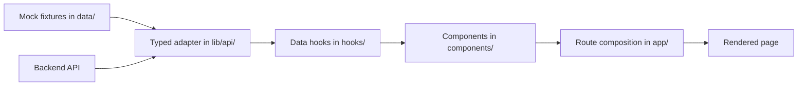

# Project Architecture

The frontend is a Next.js App Router application. Routes compose reusable UI, while hooks and libraries keep state and domain behavior out of presentation where practical. The project can run against bundled mock data or a backend API.

## Folder Responsibilities

| Folder | Responsibility |
| --- | --- |
| `app/` | Route segments and page-level composition. A `page.tsx` file exposes a route; layouts, providers, and global styles establish shared application structure. |
| `components/` | Reusable visual elements, organized by role and feature (for example, `ui/`, `charts/`, `dashboard/`, and `wallet/`). Components render data and forward user actions to hooks or callbacks. |
| `lib/` | Domain logic and integrations that are not tied to React rendering: API adapters, formatting, persistence, calculations, and other reusable services. `lib/api/` is the typed data-access boundary. |
| `hooks/` | Reusable React behavior and state. Data hooks can wrap the API with TanStack Query; interaction hooks can coordinate browser state and domain utilities. |
| `contexts/` | Cross-cutting state shared across parts of the component tree, such as wallet, theme, connection status, and circle comparison state. Providers are mounted from the application setup. |
| `data/` | Bundled fixtures and seed data used for local/demo behavior and other static application content. Mock API adapters import these fixtures. |
| `types/` | Shared TypeScript domain models used by routes, components, hooks, and libraries. Prefer importing a shared type over redefining the same shape at a call site. |

`config/` holds application configuration. For example, `config/features.ts` defines feature-spotlight content and whether each spotlight is active.

## Data Flow

For data-backed features, prefer the typed API and hook path. In mock mode, the adapter reads fixtures in `data/`; with an HTTP adapter configured, it requests data from the backend. A hook exposes loading, error, and result state to the UI.

The diagram describes the preferred path, not every current page. Some existing pages import `data/` directly; when extending those areas, avoid adding new direct fixture dependencies if the feature belongs behind the typed API and a hook.

## Adding a Page or Feature

### New page

1. Add a route segment under `app/` and expose it with a `page.tsx` file. Add a `layout.tsx` only when the route needs a distinct shared shell.
2. Keep the page focused on route-level composition. Put reusable presentation in the closest appropriate `components/` subfolder.
3. Put reusable React state and data fetching in `hooks/`; put framework-independent domain logic or integrations in `lib/`.
4. Use shared models from `types/`. If the page needs server data, extend the typed API and provide a hook rather than coupling presentation to a fixture.
5. Reuse shared providers and components where appropriate, and verify the route with the project lint/build scripts.

### Feature spotlight

`config/features.ts` currently configures **feature spotlights**, not general availability or rollout flags. To add a spotlight, add a uniquely identified entry to `SHIPPED_FEATURES`, then wrap the relevant UI with `FeatureSpotlight` using the same `featureId`. Set `active` to `false` to disable that spotlight globally. The hook remembers user dismissals in local storage.

Do not use `active` to gate the underlying product feature: it only controls whether its spotlight is shown. If a feature needs a true rollout flag, define that separately with an explicit availability/configuration mechanism and use it consistently at the feature boundary.